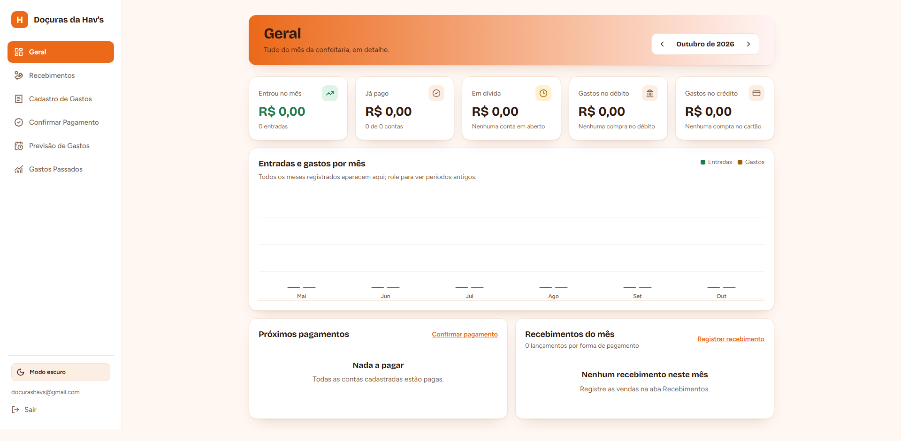
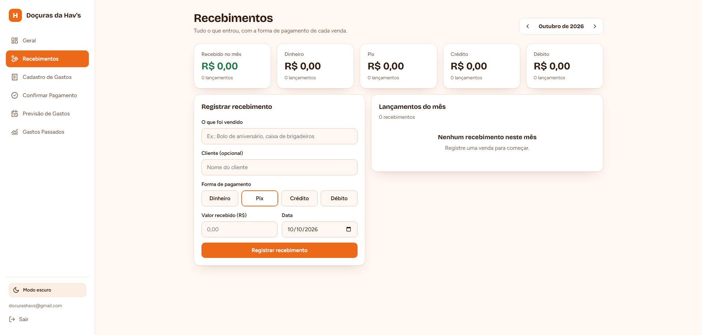
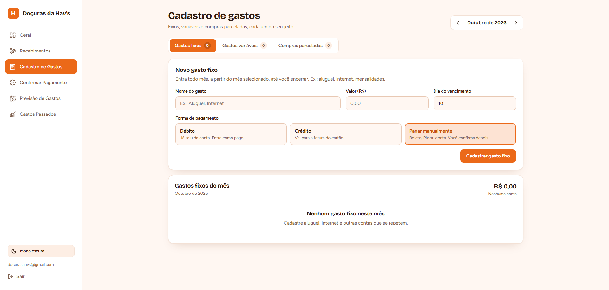
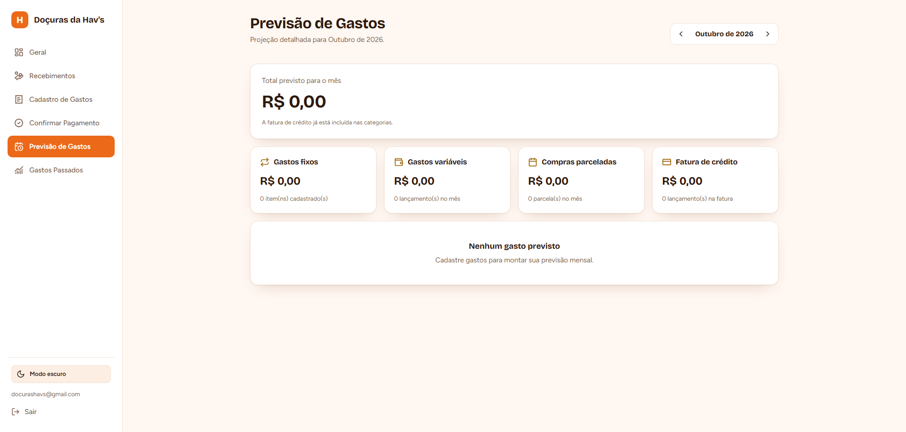
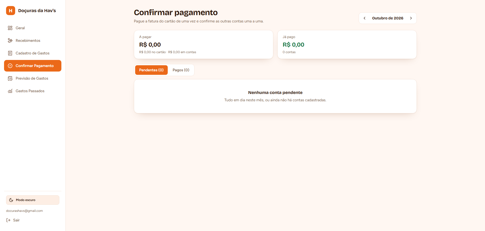
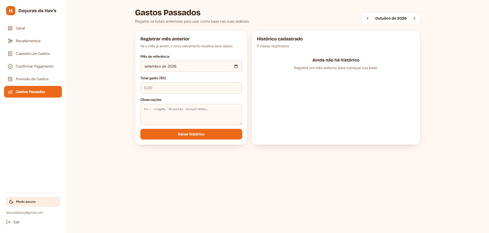

# 💳 Minhas Finanças — Dashboard Financeiro Pessoal

Um sistema web completo e moderno de gestão financeira pessoal, projetado para o controle detalhado de despesas fixas, variáveis, compras parceladas e gerenciamento de faturas de cartão de crédito, com suporte a múltiplos usuários e projeções mensais.

---

## 📸 Demonstração da Aplicação

### 📊 Visão Geral (Dashboard)
Painel principal consolidado com resumos do mês, gráficos dinâmicos e próximos pagamentos.

  

### 💰 Recebimentos
Acompanhamento detalhado de entradas, receitas do mês e controle das fontes de recebimento.

  

### 📝 Cadastro de Gastos
Gerenciamento flexível de despesas divididas entre fixas, variáveis e compras parceladas, com suporte a formas de pagamento por débito, crédito ou manual.

  

### 🔮 Previsão de Gastos
Projeção detalhada e categorizada das despesas previstas para os meses subsequentes.

  

### ✅ Confirmação de Pagamento
Módulo dedicado para controle e quitação de contas pendentes, baixas de despesas e fechamento de faturas.

  

### 📈 Gastos Passados
Registro e histórico consolidado de meses anteriores para análise e comparação do hábito financeiro.

  

---

## ⚙️ Principais Funcionalidades

- **Controle de Gastos Flexível:** Cadastro de despesas fixas (recorrentes), variáveis e compras parceladas.
- **Gestão de Cartão de Crédito:** Definição personalizada de dias de fechamento e vencimento de fatura, com alocação automática de compras para o mês correto.
- **Múltiplas Formas de Pagamento:** Suporte a pagamentos via débito automático (com indicação do banco), cartão de crédito ou pagamento manual.
- **Segurança e Isolamento por Usuário (RLS):** Garantia de privacidade e isolamento total de dados entre usuários utilizando Row Level Security no PostgreSQL.
- **Histórico e Projeções:** Acompanhamento retroativo de meses passados e painel de planejamento para meses futuros.

---

## 🚀 Tecnologias Utilizadas

- **Front-end:** React, Vite, JavaScript / TypeScript, Tailwind CSS
- **Back-end & Banco de Dados:** Supabase (PostgreSQL)
- **Segurança & Autenticação:** Supabase Auth & Row Level Security (RLS)
- **Hospedagem & Deploy:** Vercel